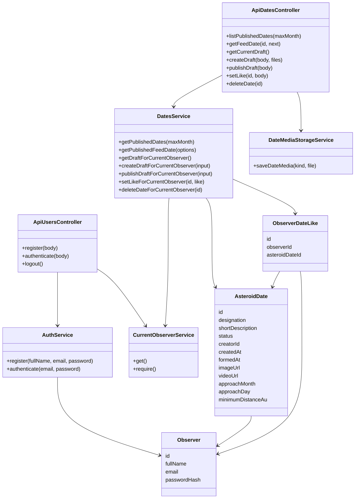

# Диаграммы ЛР4 — Asteroid Dates

Откройте `asteroid-dates-lab4.mdj` в StarUML. Проект содержит диаграмму классов **01 Классы — операции для signature** и Sequence **02 Sequence — HTTP и домены**.

В Sequence представлены SPA, домены пользователей/астероидов и сервисы предметной области. База данных и нативное приложение отсутствуют. `users.asteroids.local` и `api.asteroids.local` — логические обозначения доменов на диаграмме, фактический адрес обоих HTTP-контроллеров при локальном запуске — `http://localhost:3000`.

Каждый `UMLMessage.signature` — `$ref` на существующий `UMLOperation` из диаграммы классов. У сообщения выбран метод, а не просто введено похожее название. В `arguments` записаны HTTP-метод, маршрут, ключевые входные данные или выходные данные/статус; StarUML показывает их в скобках. Для проверки выберите стрелку → Properties → `signature`, затем `arguments`. Общие операции можно найти в Model Explorer под соответствующим классом. Генератор и проверка целостности ссылок находятся в `scripts/build_lab4_assets.py`.

## Диаграмма классов



## Sequence: полный HTTP-сценарий

```mermaid
sequenceDiagram
  autonumber
  participant SPA as Браузер SPA
  participant Users as users.asteroids.local / ApiUsersController
  participant Auth as AuthService
  participant API as api.asteroids.local / ApiDatesController
  participant Media as DateMediaStorageService
  participant Dates as DatesService

  SPA->>Users: authenticate(POST /api/users/auth; email, password)
  Users->>Auth: authenticate(email, password)
  Auth-->>Users: observer(id, fullName, email)
  Users-->>SPA: 200; Set-Cookie asteroids.sid; authenticated=1

  SPA->>API: listPublishedDates(GET /api/dates?maxMonth=7)
  API->>Dates: getPublishedDates(maxMonth=7)
  API-->>SPA: 200; data=[published dates]

  SPA->>API: createDraft(POST /api/dates; designation, image, video; Cookie)
  API->>Media: saveDateMedia(image, imageFile → imageUrl)
  API->>Media: saveDateMedia(video, videoFile → videoUrl)
  API->>Dates: createDraftForCurrentObserver(designation, imageUrl, videoUrl)
  API-->>SPA: 201; data(id, status=draft, creatorId)

  SPA->>API: getCurrentDraft(GET /api/dates/draft; Cookie)
  API->>Dates: getDraftForCurrentObserver()
  API-->>SPA: 200; data(id, designation, поля черновика)

  SPA->>API: publishDraft(PUT /api/dates/publish; описание, месяц, день, расстояние; Cookie)
  API->>Dates: publishDraftForCurrentObserver(поля публикации)
  API-->>SPA: 200; data(id, status=published, formedAt, обновлённые поля)

  SPA->>API: getFeedDate(GET /api/dates/feed; без id)
  API->>Dates: getPublishedFeedDate(options={})
  API-->>SPA: 200; data=[первая карточка]

  SPA->>API: getFeedDate(GET /api/dates/feed?id=2&next=true)
  API->>Dates: getPublishedFeedDate(id=2, next=true)
  API-->>SPA: 200; data=[следующая карточка]

  SPA->>API: setLike(POST /api/dates/2/like; like=1; Cookie)
  API->>Dates: setLikeForCurrentObserver(id=2, like=1)
  API-->>SPA: 200; data(like=1, date.isLiked=1, date.likesCount)
```

Гость может выполнить обе операции чтения списка и ленты. Для создания, чтения черновика, публикации и лайка необходима действующая cookie; без неё контроллер вернёт 401 до выполнения метода. Автор определяется сервером из сессии, поэтому `creatorId` отсутствует среди входных полей.
